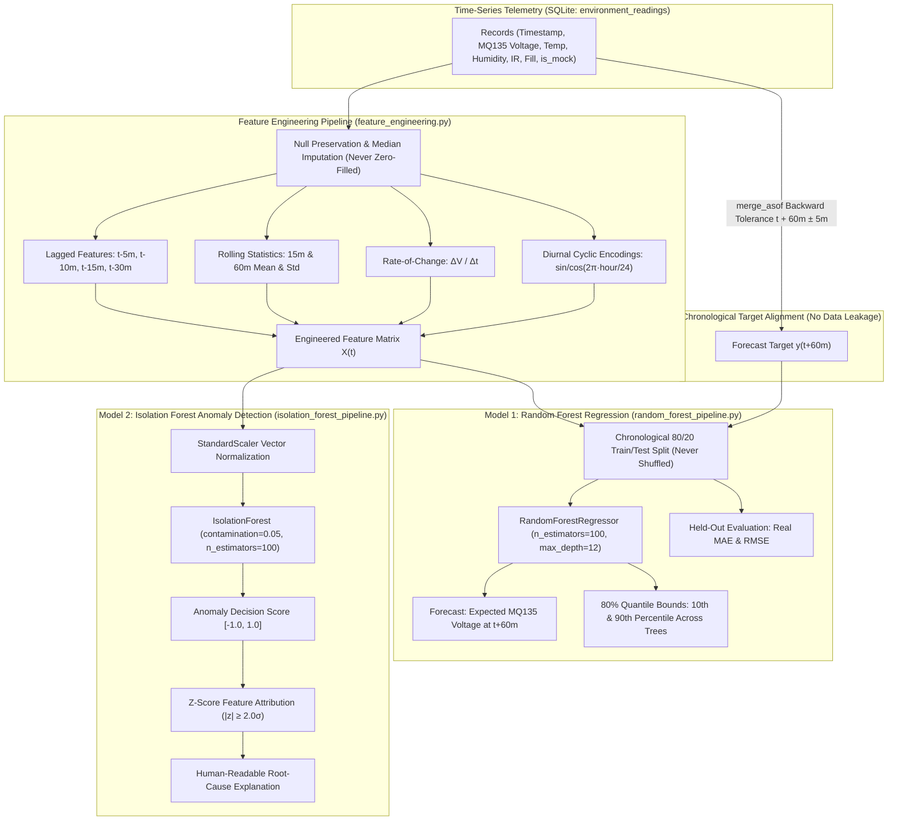

# Environmental Machine Learning Pipelines: Architecture, Training & Validation Manual

**System:** AI-Powered Multi-Sensor Environmental Monitoring and Prediction System  
**Framework:** Scikit-Learn (1.4+), Pandas, NumPy, Joblib  
**Implementation Directory:** `backend/app/ml/environment/`  
**Persistence Directory:** `backend/app/ml/models/`  

---

## 1. Machine Learning Architecture Overview

The environmental monitoring backend incorporates two distinct, complementary machine learning pipelines designed specifically for edge-ingested tabular time-series:



---

## 2. Feature Engineering Pipeline (`EnvironmentalFeatureEngineer`)

### 2.1 Feature Definitions
For every timestamp $t$, the pipeline constructs a 13-dimensional feature vector:

| Feature Name | Derivation | Physical Rationale |
| :--- | :--- | :--- |
| `mq135_voltage_current` | $V(t)$ | Immediate baseline gas voltage |
| `mq135_voltage_lag_5m` | $V(t - 5\text{m})$ | Short-term inertia |
| `mq135_voltage_lag_10m` | $V(t - 10\text{m})$ | Rate confirmation |
| `mq135_voltage_lag_15m` | $V(t - 15\text{m})$ | Medium-term trend |
| `mq135_voltage_lag_30m` | $V(t - 30\text{m})$ | Baseline drift reference |
| `mq135_rolling_mean_15m` | $\frac{1}{N}\sum_{i=0}^{N-1} V(t - i\Delta t)$ | High-frequency noise suppression |
| `mq135_rolling_std_15m` | $\sqrt{\frac{1}{N}\sum (V - \bar{V})^2}$ | Atmospheric turbulence / volatility metric |
| `mq135_rate_of_change` | $\frac{V(t) - V(t - 5\text{m})}{5\text{m}}$ | Velocity of gas buildup or dissipation |
| `temperature_c` | $T(t)$ | Air temperature covariate |
| `humidity_percent` | $H(t)$ | Relative humidity covariate |
| `ir_count` | $\text{IR}(t)$ | Footfall proxy for human indoor presence |
| `bin_fill_percent` | $\text{Fill}(t)$ | Waste accumulation proxy |
| `hour_sin` & `hour_cos` | $\sin\left(\frac{2\pi \cdot h}{24}\right), \cos\left(\frac{2\pi \cdot h}{24}\right)$ | Cyclic encoding preserving continuous $23\text{h} \to 0\text{h}$ distance |

### 2.2 Prevention of Future Data Leakage
- **Rolling Lookback Only:** Rolling aggregates and rate-of-change computations strictly look backward in time ($t - \tau \le t$). They never incorporate future values ($t + \tau$).
- **Strict Chronological Splitting:** The dataset is never randomly shuffled. The earliest 80% of timestamped rows form the training set, and the subsequent 20% form the validation set.
- **Asynchronous Target Alignment:** `pandas.merge_asof` joins each feature record with the first observed future reading within $[t + 55\text{m}, t + 65\text{m}]$. Observations near the end of the series that have no valid future reading are omitted from the training matrix.

### 2.3 Safe Missing-Sensor Imputation
- Disconnected or timeout sensor values are stored as SQL `NULL` and loaded into pandas as `np.nan`.
- The pipeline **never replaces missing sensor data with zero**, because $0^\circ\text{C}$ or $0\text{V}$ are valid physical measurements.
- Instead, missing values are imputed using the column **median** calculated exclusively on the training split.

---

## 3. Model 1: Random Forest Regression (1-Hour Ahead MQ135 Forecast)

### 3.1 Hyperparameters
```python
RandomForestRegressor(
    n_estimators=100,        # 100 decision trees
    max_depth=12,            # Prevents memorizing high-frequency sensor noise
    min_samples_split=5,     # Requires minimum support for splits
    min_samples_leaf=2,      # Regularization against outliers
    random_state=42,         # Fully deterministic reproduction
    n_jobs=-1                # Parallel CPU execution
)
```

### 3.2 80% Quantile Prediction Intervals
Standard regression yields only a single expected point, leaving operators blind to model uncertainty.  
Our `RandomForestForecaster` queries each of the 100 underlying decision tree estimators:
$$\hat{y}_k = T_k(X), \quad k \in \{1, 2, \dots, 100\}$$

From this empirical distribution of predictions, the pipeline extracts:
- **Expected Forecast:** Mean prediction $\hat{y} = \frac{1}{100}\sum_{k=1}^{100} \hat{y}_k$.
- **Lower Bound (10th Percentile):** $\hat{y}_{\text{lower}} = \text{Percentile}_{10}(\{\hat{y}_k\})$.
- **Upper Bound (90th Percentile):** $\hat{y}_{\text{upper}} = \text{Percentile}_{90}(\{\hat{y}_k\})$.

This delivers a true 80% predictive confidence interval displayed visually on the Next.js dashboard.

### 3.3 Evaluation Metrics
The pipeline computes real error metrics strictly on the held-out 20% evaluation split:
- **Mean Absolute Error (MAE):** $\text{MAE} = \frac{1}{N}\sum |y_i - \hat{y}_i|$
- **Root Mean Squared Error (RMSE):** $\text{RMSE} = \sqrt{\frac{1}{N}\sum (y_i - \hat{y}_i)^2}$
- **Coefficient of Determination ($R^2$):** $R^2 = 1 - \frac{\sum (y_i - \hat{y}_i)^2}{\sum (y_i - \bar{y})^2}$

---

## 4. Model 2: Isolation Forest (Multivariate Anomaly Detection)

### 4.1 Principle of Operation
Isolation Forest operates by recursively partitioning feature space using random orthogonal splits. Outlier observations that deviate from normal multidimensional clusters require significantly fewer splits to isolate (shorter path lengths in the trees).

### 4.2 Hyperparameters
```python
IsolationForest(
    n_estimators=100,        # 100 isolation trees
    contamination=0.05,      # 5% expected baseline anomalies
    max_samples="auto",      # Standard 256 sample subsamples
    random_state=42          # Deterministic seed
)
```

### 4.3 Root-Cause Feature Attribution
When an observation is flagged as an outlier (decision score $< 0$), operators need to know *which* sensor caused the alert.  
The pipeline standardizes the feature vector against the training set mean $\mu_j$ and standard deviation $\sigma_j$:
$$z_j = \frac{x_j - \mu_j}{\sigma_j}$$

Any feature where $|z_j| \ge 2.0$ (exceeding two standard deviations) is flagged as a primary driving factor. The backend translates these into human-readable diagnostics:
- *Example:* `"Anomaly detected (Score: -0.184). Key drivers: MQ135 Gas Voltage (+3.4σ above baseline), Rate of Change (+2.8σ). Suggested action: Inspect local area for gas leakage or solvent vapors."*

---

## 5. Model Lifecycle & Production API Contracts

### 5.1 Training Requirements & Waiting Status
To prevent publishing misleading statistics on untrained or empty datasets:
- If fewer than **100 historical readings** exist for a node, endpoints return:
  ```json
  {
    "device_id": "env_node_001",
    "status": "WAITING_FOR_DATA",
    "samples_available": 14,
    "min_samples_required": 100,
    "message": "Insufficient historical readings for reliable machine learning inference."
  }
  ```
- The dashboard visualizer displays an informative progress status rather than crashing.

### 5.2 Model Serialization
Trained pipelines are persisted as serialized artifacts:
- `backend/app/ml/models/rf_forecaster_{device_id}.joblib`
- `backend/app/ml/models/if_detector_{device_id}.joblib`
- `backend/app/ml/models/feature_metadata_{device_id}.json`

---

## 6. Scientific Limitations & Disclosure

1. **Uncalibrated Sensor Voltage:** The Random Forest model forecasts the **analog voltage** response ($0.0\text{V} - 3.3\text{V}$) of the MQ135 sensor. This accurately captures relative atmospheric gas buildup or decay, but **cannot be interpreted as certified ppm or regulatory AQI** without certified multi-point gas chamber calibration.
2. **Sensor Cross-Sensitivity:** The MQ135 reacts to ammonia, nitrogen oxides, alcohol, benzene, and smoke. The model detects atmospheric changes, but cannot differentiate between distinct chemical species without multi-sensor gas chromatography.
3. **No Direct Actuation:** Outlier classifications are diagnostic notifications intended for operator awareness. They must not directly actuate high-voltage ventilation fans or emergency shutoffs without secondary hardware interlocks.
