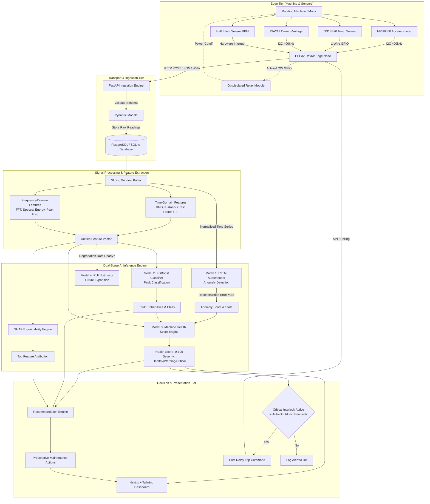
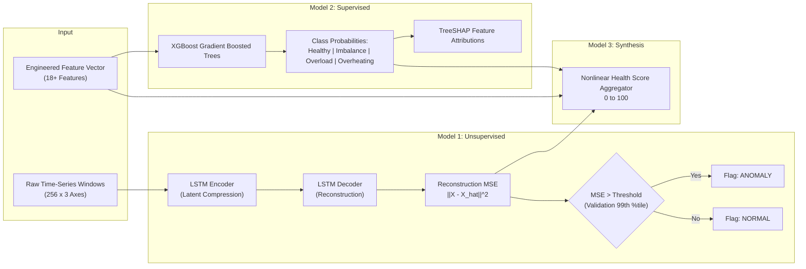
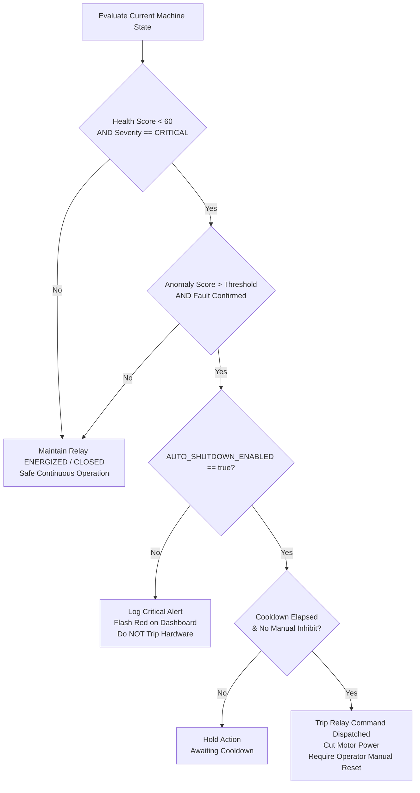
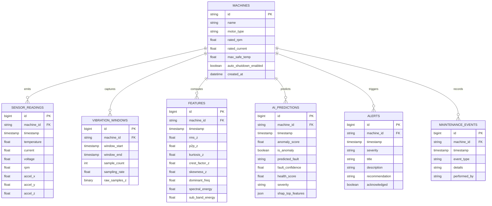

# System Architecture: AIoT-Based Machine Health Monitoring and Predictive Maintenance

## 1. Executive Architecture Overview

The **AIoT-Based Machine Health Monitoring and Predictive Maintenance System** is an end-to-end cyber-physical industrial IoT framework designed for continuous condition monitoring of rotating machinery (electric motors, pumps, fans, and drivetrains). 

The core operational principle is **SENSE → ANALYZE → DECIDE → ACT**:
1. **SENSE**: Real-time synchronous and asynchronous acquisition of physical parameters (3-axis high-frequency vibration, core/ambient temperature, operating current/voltage, and shaft rotational speed/RPM) via an ESP32 microcontroller edge node.
2. **ANALYZE**: High-throughput ingestion through a FastAPI backend, feature engineering via time-domain and frequency-domain (FFT) signal processing, followed by dual-stage Machine Learning inference (unsupervised LSTM Autoencoder anomaly detection + supervised XGBoost fault classification).
3. **DECIDE**: Deterministic and explainable synthesis into a normalized 0–100 Machine Health Score, coupled with TreeSHAP explainability and rule-augmented maintenance recommendations.
4. **ACT**: Closed-loop operator alerting, interactive dashboard visualization, and fail-safe hardware protection via an optoisolated relay module governed by strict multi-variable interlocks and cooldown guards.

---

## 2. Ingestion & Communication Architecture

### 2.1 Protocol Choice: HTTP REST vs. MQTT
- **Initial Implementation: HTTP REST**
  - **Rationale**: Direct point-to-point stateless communication, immediate HTTP status code feedback (201 Created, 422 Unprocessable Entity, 503 Unavailable), simpler debugging with tools like `curl` and Swagger UI (`/docs`), zero broker dependencies during initial bench bring-up.
  - **Payload Structure**: Batch JSON packets containing sensor time-series windows or high-rate summary vectors.
  - **ESP32 Client Strategy**: Non-blocking asynchronous HTTP client with exponential backoff retry and circular RAM buffer to prevent data loss during transient Wi-Fi drops.

- **Future Extensibility: MQTT (Message Queuing Telemetry Transport)**
  - Architecture isolates ingestion behind a service repository layer. The FastAPI backend can subscribe to an MQTT broker (e.g., Eclipse Mosquitto) via `asyncio-mqtt` or `paho-mqtt` using identical Pydantic data schemas without modifying downstream processing pipelines.

### 2.2 Telemetry Ingestion Contract & Validation Boundaries
- **Ingestion Endpoint**: `POST /api/v1/telemetry`
- **Validation Philosophy**:
  - Strict Pydantic v2 schemas reject malformed JSON, NaN, Inf, and readings outside physical sanity envelopes (`[-20C, 130C]` temperature, non-negative current/voltage/RPM, $\pm 16g$ acceleration).
  - Validation boundaries are strictly data-integrity guards and **not** AI fault detection thresholds.
- **Persistence Table**: `sensor_readings` captures raw metrics with microsecond UTC timestamps and `is_mock` provenance flags without mixing preliminary ML predictions.

### 2.3 Historical Time-Series Query Engine & Pagination
- **Endpoints**:
  - `GET /api/v1/machine/{device_id}/latest`: Fast indexed retrieval of latest telemetry frame for machine card status.
  - `GET /api/v1/machine/{device_id}/history`: Time-window lookback with chronological (`ASC`) ordering for signal processing buffers.
- **Index Optimization**:
  - Queries leverage the composite B-Tree index `ix_sensor_device_timestamp` on `(device_id, timestamp)`.
  - Avoids memory sort buffers and scans only the specified time slice.
- **Scalable Cursor-Based Pagination**:
  - Replaces $O(N)$ database `OFFSET` scans with monotonic cursor tuples `(timestamp, id) > (:cursor_ts, :cursor_id)`.
  - Delivers constant-time $O(1)$ page traversal across millions of time-series samples without drift or duplicated items.

---

## 3. Vibration Sampling & Signal Processing Pipeline

Vibration is the single most diagnostic parameter for rotating machinery. Mechanical defects (mass unbalance, shaft misalignment, bearing raceway spalling, gear mesh faults) manifest as specific frequency signatures and acceleration peaks.

### 3.1 Sampling Strategy and Parameters

| Parameter | Default Value | Technical Rationale |
| :--- | :--- | :--- |
| **Sampling Rate ($f_s$)** | $200\text{ Hz}$ – $1000\text{ Hz}$ | For a standard laboratory DC motor running at $1200\text{ – }3000\text{ RPM}$ ($20\text{ – }50\text{ Hz}$ fundamental rotational frequency $1\times$), Nyquist criterion ($f_{nyq} = f_s / 2$) mandates $f_s \ge 2 \times f_{max}$. A sampling rate of $200\text{ Hz}$ accurately captures up to $100\text{ Hz}$ (covering fundamental and $2\times$ harmonics). At $1000\text{ Hz}$, harmonics up to $500\text{ Hz}$ (bearing ball pass frequencies) are resolved. |
| **Window Size ($N$)** | $256$ or $512$ samples | Powers of 2 ($2^k$) optimize Fast Fourier Transform (FFT) computational complexity ($O(N \log N)$ via Cooley-Tukey). $N=256$ at $200\text{ Hz}$ yields a $1.28\text{ s}$ observation window with frequency resolution $\Delta f = f_s / N = 200 / 256 \approx 0.78\text{ Hz}$. |
| **Window Overlap** | $50\%$ (128 samples) | Preserves transient event information across window edges where windowing functions (e.g., Hanning) attenuate amplitudes near window boundaries. |
| **Anti-Aliasing & Filtering** | Digital IIR / Butterworth | High-pass filter at $1\text{ Hz}$ to eliminate gravity/DC bias and sensor tilt; optional low-pass filter at $0.45 \times f_s$ to reject high-frequency acoustic/electrical noise. |

### 3.2 Time-Domain Feature Extraction
Given discrete acceleration window $x = [x_1, x_2, \dots, x_N]$:
1. **Mean ($\mu$)**: $\mu = \frac{1}{N}\sum_{i=1}^N x_i$
2. **Standard Deviation ($\sigma$) & Variance ($\sigma^2$)**: $\sigma = \sqrt{\frac{1}{N-1}\sum_{i=1}^N (x_i - \mu)^2}$
3. **Root Mean Square (RMS)**: Measures total energy and continuous vibration severity:
   $$\text{RMS} = \sqrt{\frac{1}{N}\sum_{i=1}^N x_i^2}$$
4. **Peak & Peak-to-Peak ($V_{p-p}$)**: $\text{Peak} = \max(|x_i|)$, $V_{p-p} = \max(x_i) - \min(x_i)$
5. **Crest Factor**: Indicates impact severity (early bearing faults cause high impulsive peaks before overall energy increases):
   $$\text{CF} = \frac{\text{Peak}}{\text{RMS}}$$
6. **Kurtosis**: 4th statistical moment, sensitive to spikiness and impulsive shocks (Gaussian normal = 3.0; bearing defects > 4.5):
   $$\text{Kurtosis} = \frac{\frac{1}{N}\sum_{i=1}^N (x_i - \mu)^4}{\sigma^4}$$
7. **Skewness**: 3rd statistical moment, measures waveform asymmetry:
   $$\text{Skewness} = \frac{\frac{1}{N}\sum_{i=1}^N (x_i - \mu)^3}{\sigma^3}$$

### 3.3 Frequency-Domain Feature Extraction
1. **FFT Magnitude Spectrum**: Computed with Hanning window to prevent spectral leakage:
   $$X[k] = \sum_{n=0}^{N-1} x[n] w[n] e^{-j 2\pi k n / N}$$
2. **Dominant Frequency**: Peak frequency bin $f_{dom} = \arg\max_k |X[k]| \cdot \Delta f$
3. **Spectral Energy**: Total power under the spectrum $\sum_{k=0}^{N/2} |X[k]|^2$
4. **Sub-Band Energies**:
   - Sub-synchronous band ($0.1\times – 0.8\times$ RPM): Belt looseness, oil whirl.
   - 1× RPM band ($0.9\times – 1.1\times$ RPM): Mass unbalance.
   - 2× RPM band ($1.9\times – 2.1\times$ RPM): Angular/parallel shaft misalignment.
   - High-frequency band ($>3\times$ RPM): Bearing raceway impacts and gear mesh harmonics.

---

## 4. Machine Learning & Inference Architecture

### 4.1 Model 1: LSTM Autoencoder (Unsupervised Anomaly Detection)
- **Principle**: Electric machines operate in a healthy baseline regime for >95% of their lifecycle. Training an unsupervised autoencoder exclusively on verified healthy vibration and operating data enables the model to compress and reconstruct normal dynamics with minimal Mean Squared Error (MSE).
- **Network Topology**:
  - Input: $[B, T, D] = [\text{batch}, 256, 3]$ (3-axis normalized acceleration).
  - Encoder: 2-layer stacked LSTM ($\text{units}=64 \to 32$) with Dropout (0.2).
  - Latent Representation: Dense bottleneck vector of dimension 16.
  - Decoder: RepeatVector followed by 2-layer stacked LSTM ($\text{units}=32 \to 64$).
  - TimeDistributed Dense layer reconstructing original 3-axis dimension.
- **Threshold Determination**:
  - The anomaly threshold $\tau$ is derived empirically using the validation healthy set:
    $$\tau = \mu_{\text{val\_MSE}} + 3 \times \sigma_{\text{val\_MSE}} \quad \text{or} \quad \text{Percentile}_{99}(\text{val\_MSE})$$
  - Any reconstruction error exceeding $\tau$ indicates that the vibration profile has departed from healthy manifold dynamics.

### 4.2 Model 2: XGBoost Classifier (Supervised Fault Classification)
- **Purpose**: Discriminate specific fault modes once an anomaly is indicated or for continuous fingerprinting.
- **Input Dimensions**: 18+ engineered features:
  - Temperature, Motor Current, Measured RPM, Current/RPM Ratio.
  - X, Y, Z Vibration RMS, Peak-to-Peak, Kurtosis, Crest Factor, Skewness.
  - Dominant frequency, $1\times$ RPM spectral power, $2\times$ RPM spectral power, High-frequency power.
- **Target Classes**:
  - `0 = Healthy`: Nominal operation.
  - `1 = Imbalance`: High $1\times$ RPM vibration, normal current/temperature.
  - `2 = Overload`: Elevated motor current, decreased RPM (slip), moderate vibration increase.
  - `3 = Overheating`: High temperature trend exceeding thermal dissipation curves.
- **Confidence & Probabilities**: Returns multi-class softmax probability distribution with entropy-based prediction confidence.

### 4.3 Model 3: Transparent Machine Health Score (0–100)
To avoid arbitrary "black box" indicators, the health score $H \in [0, 100]$ fuses physical standards (ISO 10816 vibration severity) and machine learning outputs:
$$H = 100 - \left( w_1 \cdot S_{\text{anomaly}} + w_2 \cdot (1 - P_{\text{healthy}}) + w_3 \cdot D_{\text{temp}} + w_4 \cdot D_{\text{curr}} + w_5 \cdot D_{\text{rpm}} \right)$$
Where:
- $S_{\text{anomaly}} \in [0, 100]$: Scaled autoencoder reconstruction error relative to threshold $\tau$.
- $P_{\text{healthy}}$: XGBoost probability of nominal class.
- $D_{\text{temp}}$: Thermal penalty exceeding continuous rating threshold $T_{\text{nominal}}$.
- $D_{\text{curr}}$: Current deviation penalty exceeding full-load amps (FLA).
- $D_{\text{rpm}}$: Rotor slip penalty (speed drop under constant voltage).
- Weights $\sum w_i = 1.0$ (configurable in settings).

**Health Classifications**:
- **85 – 100: HEALTHY** (Normal operating envelope, routine monitoring).
- **60 – 84: WARNING** (Nascent defect, elevated stress, schedule scheduled maintenance).
- **0 – 59: CRITICAL** (Imminent failure or severe operational hazard, inspect immediately).

### 4.4 Model 4: Remaining Useful Life (RUL) Architecture
- **Realistic Engineering Constraint**: RUL regression requires run-to-failure degradation trajectories. In accordance with strict engineering standards, the RUL interface is structured as an extensible abstract service (`RULPredictorBase`).
- **Activation Gate**: Disabled by default until adequate accelerated lifetime degradation datasets (e.g., C-MAPSS or continuous bearing run-to-failure records) are acquired and validated.

---

## 5. Explainable AI (XAI) with TreeSHAP

To provide operators with immediate actionable understanding of AI decisions:
- **SHAP (SHapley Additive exPlanations)** calculates Shapley values for each engineered feature on every XGBoost inference.
- The top-4 influential features with positive contributions toward the abnormal class are extracted.
- Example:
  - If class is classified as `Imbalance`: SHAP highlights `[1. Dominant Frequency ~ 1x RPM (+0.42), 2. Vibration RMS (+0.31), 3. Kurtosis (-0.02), 4. Temperature (0.00)]`.
  - Operator sees clear mechanical rationale rather than an opaque classification.

---

## 6. Safety Interlock & Relay Control Architecture

### Safety Principles:
1. **Never Automatically Trip by Default**: `AUTO_SHUTDOWN_ENABLED` is strictly `false` on initial startup.
2. **Multi-Condition Interlock**: A single noisy sensor glitch cannot trigger a shutdown. Tripping requires critical health score AND confirmed anomaly error.
3. **Fail-Safe Relay Wiring**: Relay is wired Normally Open (NO) or Normally Closed (NC) according to the safety profile: in industrial standard fail-safe design, the relay coil is energized during normal operation; loss of control signal or ESP32 power drops the relay, shutting down the motor.
4. **Manual Reset & Cooldown**: Once tripped, the system enters `LATCHED_TRIP` state, requiring operator confirmation in the UI to reset.

---

## 7. Database Entity-Relationship Schema

---

## 8. Summary of Component Interfaces

| Interface | Producer | Consumer | Data Protocol / Schema |
| :--- | :--- | :--- | :--- |
| **Telemetry Ingestion** | ESP32 DevKit | FastAPI Backend | `POST /api/v1/telemetry` (JSON payload) |
| **Relay Command Poll/Push** | FastAPI Backend | ESP32 DevKit | `GET /api/v1/machine/{id}/control/relay` or HTTP Response |
| **Live Machine Health** | Backend Inference | Next.js Dashboard | `GET /api/v1/machine/{id}/health` |
| **Historical Analytics** | Relational DB | Next.js Dashboard | `GET /api/v1/machine/{id}/history?hours=24` |
| **Explainable AI Attributions**| Backend SHAP Engine | Next.js Dashboard | `GET /api/v1/machine/{id}/diagnosis` |
| **Alert Management** | Backend Decision Engine| Operator UI | `GET /api/v1/machine/{id}/alerts` |
