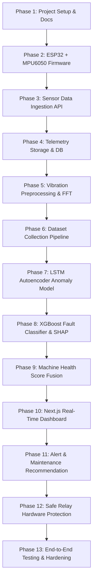

# Development Plan: AIoT Machine Health Monitoring & Predictive Maintenance

This document defines the 13-phase development roadmap for the AIoT Machine Health Monitoring prototype. Each phase must be completed, verified, and confirmed before advancing to the subsequent phase.

---

## Roadmap Overview

---

## Detailed Phase Breakdown

### Phase 1: Project Setup and Architecture Documentation (CURRENT)
- **Objective**: Establish the repository layout, comprehensive architecture specifications, hardware wiring guidelines, roadmap, and foundational environment files.
- **Key Deliverables**:
  - `ARCHITECTURE.md`: End-to-end cyber-physical pipeline, mathematical signal processing models, ML architectures, and safety interlocks.
  - `HARDWARE.md`: Bill of Materials (BOM), GPIO pin mappings, star grounding, and electrical schematic.
  - `DEVELOPMENT_PLAN.md`: Structured 13-phase implementation plan.
  - `README.md`: Project executive summary, installation guide, and tech stack details.
  - Directory skeleton: `firmware/`, `backend/`, `dashboard/`, `data/`, `models/`, `scripts/`, `docs/`.
  - Base configuration: `requirements.txt`, `.env.example`, `docker-compose.yml`.
- **Acceptance Criteria**:
  - Directory structure and markdown documentation verified.
  - No synthetic/fake data invented.
  - Ready for Phase 2 implementation approval.

---

### Phase 2: ESP32 Firmware Foundation & Sensor Interfacing
- **Objective**: Implement the ESP32 C++ firmware for the physical sensors (MPU6050, DS18B20, INA219, Hall effect RPM) with strict non-blocking acquisition, sensor health validation, and isolated MOCK_MODE for bench testing without physical hardware.
- **Key Deliverables**:
  - PlatformIO / Arduino C++ project in `firmware/esp32/`.
  - Pin configuration header `config.h`.
  - Drivers:
    - MPU6050 I2C driver (configurable sampling frequency, e.g. 200 Hz).
    - DS18B20 1-Wire temperature reader.
    - INA219 I2C current and bus voltage monitor.
    - Interrupt-driven Hall sensor RPM counter.
  - Sensor health watchdog (flags offline sensors with descriptive error codes).
  - Explicit compile-time `#define MOCK_MODE` toggle clearly separated from production hardware code.
  - Non-blocking loop using `millis()` timing and FreeRTOS task separation.
- **Acceptance Criteria**:
  - Firmware compiles cleanly.
  - Validates sensor presence on I2C bus scan (`0x68`, `0x40`).
  - Serial monitor outputs well-formed JSON telemetry matching schema.

---

### Phase 3: Sensor Data Ingestion API (FastAPI)
- **Objective**: Build the backend REST ingestion service using FastAPI, with strict Pydantic payload validation and structured logging.
- **Key Deliverables**:
  - FastAPI application structure (`backend/app/main.py`).
  - Telemetry endpoint: `POST /api/v1/telemetry`.
  - Pydantic models with range constraints:
    - Temperature ($-10^\circ\text{C}$ to $120^\circ\text{C}$)
    - Current ($0.0\text{A}$ to $5.0\text{A}$)
    - RPM ($0$ to $6000\text{ RPM}$)
    - Acceleration ($\pm 16g$)
  - Immediate rejection of physically impossible sensor values (`422 Unprocessable Entity`).
  - Structured request logging with request duration and source IP.
- **Acceptance Criteria**:
  - Unit tests verify schema rejection on corrupt inputs.
  - Endpoint passes load testing with 100 req/sec without latency spikes.

---

### Phase 4: Telemetry Storage & Database Schema
- **Objective**: Implement relational database persistence using SQLAlchemy (PostgreSQL / SQLite support).
- **Key Deliverables**:
  - Database models: `Machine`, `SensorReading`, `VibrationWindow`, `FeatureRecord`, `AIPrediction`, `Alert`, `MaintenanceEvent`.
  - Async database session management and repository pattern.
  - Alembic database migration scripts.
  - Query endpoints:
    - `GET /api/v1/machine/{id}/latest`
    - `GET /api/v1/machine/{id}/history?hours=N`
- **Acceptance Criteria**:
  - Automated database initialization test.
  - CRUD operations verified with Pytest.

---

### Phase 5: Vibration Preprocessing & Feature Extraction Engine
- **Objective**: Build the Python signal processing pipeline for accelerometer time series.
- **Key Deliverables**:
  - `backend/ml/preprocessing/filter.py`: High-pass IIR Butterworth filter (1 Hz cutoff to remove DC tilt/gravity).
  - `backend/ml/preprocessing/windowing.py`: Sliding window slicer with configurable `WINDOW_SIZE` (default 256) and `OVERLAP` (default 50%).
  - `backend/ml/features/time_domain.py`: RMS, variance, peak-to-peak, kurtosis, skewness, crest factor.
  - `backend/ml/features/frequency_domain.py`: Fast Fourier Transform (FFT) with Hanning window, dominant frequency estimation, total spectral energy, and sub-band harmonic energy.
  - Unit tests verifying mathematical correctness against synthetic sine and impulse waves.
- **Acceptance Criteria**:
  - Exact feature calculation matches analytical benchmark values.
  - Processing latency $< 10\text{ ms}$ per 256-sample window.

---

### Phase 6: Dataset Collection & Labelling Pipeline
- **Objective**: Provide structured tooling to capture and label healthy baseline and controlled anomaly runs without fabricating fake data.
- **Key Deliverables**:
  - `scripts/collect_data.py`: CLI tool streaming from ESP32 or serial port to CSV with label tags (`healthy`, `imbalance`, `overload`, `overheating`).
  - `scripts/prepare_dataset.py`: Slices raw telemetry into sliding windows, computes feature vectors, and generates partitioned Train/Validation/Test splits with chronological ordering.
  - Sample dataset format definitions in `data/sample/`.
- **Acceptance Criteria**:
  - Dataset generator produces zero data leakage across train and test windows.
  - Complete data provenance metadata logged.

---

### Phase 7: Model 1 - LSTM Autoencoder (Anomaly Detection)
- **Objective**: Train and export an unsupervised LSTM Autoencoder on healthy vibration sequences.
- **Key Deliverables**:
  - PyTorch / TensorFlow LSTM Autoencoder architecture in `backend/ml/anomaly/`.
  - `scripts/train_anomaly_model.py`: Script training on healthy time series windows.
  - Dynamic threshold determination: $\tau = \mu_{\text{val\_MSE}} + 3\sigma_{\text{val\_MSE}}$ (or 99th percentile).
  - Inference service calculating reconstruction MSE and outputting `anomaly_score` and `is_anomaly`.
  - Precision, Recall, and ROC-AUC evaluation on validation datasets.
- **Acceptance Criteria**:
  - Normal healthy windows reconstruct with MSE consistently below $\tau$.
  - Artificially perturbed windows trigger `is_anomaly = True`.

---

### Phase 8: Model 2 - XGBoost Fault Classification & Explainability (TreeSHAP)
- **Objective**: Train a multi-class XGBoost classifier on engineered vibration + DC features to categorize fault states, paired with TreeSHAP for explainability.
- **Key Deliverables**:
  - `scripts/train_fault_classifier.py`: Trains `XGBClassifier` with cross-validation.
  - Metrics evaluation: Confusion Matrix, Multi-class Log-loss, F1-scores.
  - `backend/ml/classification/shap_explainer.py`: Computes top-4 feature attributions explaining the predicted fault.
  - Prediction endpoint: `GET /api/v1/machine/{id}/diagnosis`.
- **Acceptance Criteria**:
  - Classification pipeline outputs class probabilities and SHAP explanations matching feature spikes.

---

### Phase 9: Model 3 - Machine Health Score & RUL Interface
- **Objective**: Implement a normalized 0–100 Machine Health Score synthesizing anomaly scores, fault probabilities, and operational deviations (ISO 10816 standards), plus an extensible RUL interface.
- **Key Deliverables**:
  - `backend/ml/health_score/calculator.py`: Fuses multi-sensor penalties into healthy (85–100), warning (60–84), and critical (0–59) bands.
  - `backend/ml/rul/base.py`: Abstract RUL predictor interface with safety gating.
  - Endpoint: `GET /api/v1/machine/{id}/health`.
- **Acceptance Criteria**:
  - Deterministic health score transitions smoothly across simulated degradation trajectories.

---

### Phase 10: Full-Stack Real-Time Dashboard (Next.js + TypeScript + Tailwind)
- **Objective**: Build a responsive operator dashboard displaying live machine status, sensor metrics, AI diagnosis, SHAP explanations, and interactive trends.
- **Key Deliverables**:
  - Next.js application in `dashboard/`.
  - Key UI Cards:
    - Machine Health Score Dial (0–100) with color-coded severity badges.
    - DC telemetry gauges: Temperature (°C), Current (A), RPM.
    - Vibration Time-Series & FFT Spectrum Chart.
    - AI Anomaly & XGBoost Diagnostic Card with Confidence %.
    - Explainable AI Feature Contribution Bar Chart (SHAP).
    - Maintenance Recommendation Card.
    - Relay Auto-Shutdown status indicator and manual toggle.
- **Acceptance Criteria**:
  - Zero TypeScript errors (`npm run build` succeeds).
  - Real-time updates without full page reloads.

---

### Phase 11: Alerting & Maintenance Recommendation Engine
- **Objective**: Implement rule- and AI-informed diagnostic recommendation generation and alert dispatching.
- **Key Deliverables**:
  - `backend/app/services/recommendation_engine.py`: Maps composite sensor deviations and fault classes to prescriptive guidance ("Possible mechanical imbalance. Inspect alignment...").
  - `GET /api/v1/machine/{id}/alerts` and `POST /api/v1/alerts/{id}/acknowledge`.
  - Severity classification: `INFO`, `WARNING`, `CRITICAL`.
- **Acceptance Criteria**:
  - Every detected fault generates appropriate non-alarmist, prescriptive recommendations.

---

### Phase 12: Safe Relay Hardware Protection System
- **Objective**: Implement the safety trip engine with multi-sensor interlocks, manual overrides, and cooldown protection.
- **Key Deliverables**:
  - Relay state manager in `backend/app/services/relay_service.py`.
  - Interlock logic: requires `HEALTH_CRITICAL` AND `ANOMALY_CONFIRMED` AND `AUTO_SHUTDOWN_ENABLED == True`.
  - `POST /api/v1/machine/{id}/control/relay` (manual override: FORCE_ON / FORCE_OFF / RESET).
  - Cooldown timer preventing relay chatter.
  - ESP32 firmware integration to actuate GPIO 5.
- **Acceptance Criteria**:
  - Single sensor fault does not trip relay.
  - Relay stays locked off after trip until operator explicitly resets via API/UI.

---

### Phase 13: End-to-End Validation & Documentation
- **Objective**: Conduct comprehensive hardware-in-the-loop and simulated verification, benchmarking, and complete user/developer documentation.
- **Key Deliverables**:
  - Automated integration test suite (`tests/test_end_to_end.py`).
  - Stress testing with continuous 24-hour mock streaming.
  - Complete API documentation and Hardware Bring-Up Guide in `docs/`.
  - Final project review.
- **Acceptance Criteria**:
  - All test suites passing.
  - System fully documented and ready for lab deployment.
