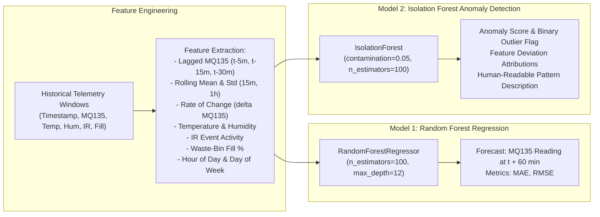

# System Migration Plan: AIoT Machine Health to AI-Powered Environmental Monitoring

## 1. Executive Summary

This document specifies the architectural transition from the **AIoT-Based Machine Health Monitoring System** to the **AI-Powered Multi-Sensor Environmental Monitoring and Prediction System**, based on the primary specification outlined in *"AI Environmental Monitoring System.pdf"*.

### Core Principles of Migration:
1. **Zero Destructive Alteration**: All existing machine-health firmware, backend routes, database records, and 24 passing automated tests remain completely intact and executable.
2. **Dual-Architecture Topology**: Environmental monitoring services, database schemas, and firmware modules operate in isolated namespaces alongside legacy machine-health modules.
3. **No Fabricated AI Claims**: Machine learning models (Random Forest regression for 1-hour ahead MQ135 forecasting and Isolation Forest for multi-sensor anomaly detection) are real scikit-learn pipelines with documented data requirements. When physical hardware or sufficient longitudinal data are absent, the system operates in an explicitly tagged **Demonstration Mode**.
4. **Hardware Electrical Safety**: ESP32 GPIOs are 3.3V-limited. Resistor voltage dividers are mandated for 5V MQ135 analog output and HC-SR04 ECHO signals.

---

## 2. Existing vs. Proposed Architecture

```mermaid
flowchart TD
    subgraph LEGACY["Preserved Machine Health Tier (Legacy)"]
        ESP_M[ESP32 Machine Node] -->|HTTP POST| API_M[FastAPI /machine/ Endpoints]
        API_M --> DB_M[(sensor_readings Table)]
    end

    subgraph PROPOSED["AI Environmental Monitoring Tier (Proposed)"]
        subgraph SENSORS["Edge Sensors & Safety Interface"]
            S_DHT[DHT22: Temp & Humidity] -->|GPIO 4 (3.3V)| ESP_E[ESP32 Environmental Node]
            S_MQ[MQ135: Air Quality] -->|5V to 3.3V Divider| ADC[GPIO 34 ADC1] --> ESP_E
            S_IR[IR Sensor: Traffic/Count] -->|GPIO 27| ESP_E
            S_US[HC-SR04: Ultrasonic Bin Fill] -->|TRIG: GPIO 5 / ECHO: 5V to 3.3V Divider| ESP_E
        end

        ESP_E -->|Wi-Fi HTTP JSON| API_E[FastAPI /environment/ Endpoints]
        API_E --> DB_E[(environment_readings Table)]
        
        DB_E --> ML_RF[Model 1: Random Forest\n1-Hour Ahead MQ135 Forecast]
        DB_E --> ML_IF[Model 2: Isolation Forest\nMulti-Sensor Anomaly Detection]
        
        ML_RF --> API_PRED[GET /environment/prediction/]
        ML_IF --> API_ANOM[GET /environment/anomalies/]
        
        API_E & API_PRED & API_ANOM --> DASHBOARD[Next.js Environmental Dashboard\nDark Green / Teal Theme]
        API_E & ML_IF --> BLYNK[Blynk IoT Integration\nVirtual Pins V0-V7 & Alerts]
    end
```

---

## 3. Reusable vs. Replaced Component Matrix

| Subsystem | Existing Component | Status | Strategy for Environmental Project |
| :--- | :--- | :--- | :--- |
| **FastAPI Core** | `main.py`, lifespan, CORS | **REUSE** | Shared application host; registers both `/api/v1/machine` and `/api/v1/environment` |
| **Logging** | `logging.py` | **REUSE** | Shared structured request latency and device tracking middleware |
| **Exceptions** | `exceptions.py` | **REUSE** | Shared JSON error formatting (400, 422, 404, 500) |
| **Database Engine**| `session.py`, `init_db.py` | **REUSE** | Shared async SQLAlchemy engine supporting SQLite (local) and PostgreSQL |
| **Pagination** | `telemetry_service.py` | **REUSE** | Reusable keyset/cursor base64 algorithm applied to environmental history |
| **Database Schema**| `sensor_readings` table | **PRESERVE** | Preserved unchanged. New table `environment_readings` added |
| **Telemetry Ingestion**| `POST /api/v1/telemetry` | **ADAPT** | Dual-payload router: accepts environmental payloads and legacy machine payloads |
| **Query Endpoints**| `GET /api/v1/machine/*` | **PRESERVE** | Kept intact. New `GET /api/v1/environment/*` routes added |
| **Firmware Toolchain**| PlatformIO + Arduino | **REUSE** | Preserved in `firmware/esp32/`. New env firmware created in `firmware/esp32_environment/` |
| **Firmware Wi-Fi** | `wifi_manager.*` | **REUSE** | Non-blocking reconnect state machine reused directly in environmental firmware |
| **Firmware Comm** | `telemetry_sender.*` | **ADAPT** | Adapted to serialize environmental JSON payload with null-sensor support |
| **Sensor Drivers** | MPU6050, DS18B20, INA219, Hall | **REPLACE** | New drivers: `dht22_sensor`, `mq135_sensor`, `ir_sensor`, `ultrasonic_sensor` |
| **AI / ML Layer** | Unimplemented scaffolding | **REPLACE** | Real scikit-learn pipelines: Random Forest regression + Isolation Forest anomalies |
| **Dashboard** | Unimplemented directory | **CREATE** | Next.js 14, TypeScript, Tailwind CSS with live metrics, trends, AI cards, and demo engine |
| **Blynk Cloud** | None | **CREATE** | Blynk REST client syncing Virtual Pins V0–V7 with alert dispatch and cooldowns |

---

## 4. Dual-Architecture Workspace Structure

```
aiot-machine-health/
├── backups/
│   └── phase1_pre_migration/         # Verified backup of requirements.txt & machine_health.db
├── MIGRATION_PLAN.md                 # This primary migration specification document
├── ARCHITECTURE.md                   # System architecture documentation
├── HARDWARE.md                       # Hardware schematics and wiring calculations
├── README.md                         # Project overview and quickstart
│
├── firmware/
│   ├── esp32/                        # PRESERVED: Machine-health firmware (MPU6050, DS18B20, INA219, Hall)
│   └── esp32_environment/            # NEW: Environmental firmware (DHT22, MQ135, IR, HC-SR04)
│       ├── platformio.ini
│       ├── include/
│       │   ├── config.h              # GPIO 4, 34, 27, 5, 18 assignments & divider constants
│       │   ├── secrets.h
│       │   └── secrets.h.example
│       └── src/
│           ├── sensors/
│           │   ├── dht22_sensor.*
│           │   ├── mq135_sensor.*
│           │   ├── ir_sensor.*
│           │   └── ultrasonic_sensor.*
│           ├── wifi/                 # Non-blocking Wi-Fi manager
│           ├── telemetry/            # JSON HTTP sender
│           └── main.cpp
│
├── backend/
│   ├── requirements.txt              # Pinned dependencies (including scikit-learn, pandas, joblib)
│   ├── app/
│   │   ├── main.py                   # FastAPI entrypoint mounting machine & environment routers
│   │   ├── core/
│   │   │   ├── config.py             # Validation boundaries for both machine and environmental sensors
│   │   │   ├── logging.py
│   │   │   └── exceptions.py
│   │   ├── database/
│   │   │   ├── session.py
│   │   │   └── init_db.py            # Initializes both sensor_readings and environment_readings
│   │   ├── models/
│   │   │   ├── telemetry.py          # PRESERVED: SensorReading (machine health)
│   │   │   └── environment.py        # NEW: EnvironmentReading, EnvironmentPrediction, EnvironmentAlert
│   │   ├── schemas/
│   │   │   ├── telemetry.py          # PRESERVED: Machine schemas
│   │   │   └── environment.py        # NEW: EnvironmentTelemetryPayload, EnvironmentRecordResponse, etc.
│   │   ├── services/
│   │   │   ├── telemetry_service.py  # PRESERVED: Machine service
│   │   │   ├── environment_service.py# NEW: Environmental persistence & history query service
│   │   │   └── blynk_service.py      # NEW: Blynk IoT virtual pin synchronization & alerts
│   │   └── api/
│   │       ├── router.py             # Aggregates /machine and /environment routers
│   │       └── v1/
│   │           ├── machine.py        # PRESERVED: /api/v1/machine/*
│   │           ├── telemetry.py      # PRESERVED: /api/v1/telemetry
│   │           └── environment.py    # NEW: /api/v1/environment/*
│   ├── ml/
│   │   ├── environment/              # NEW: Environmental AI modules
│   │   │   ├── random_forest_pipeline.py  # 1-hour ahead MQ135 regression
│   │   │   ├── isolation_forest_pipeline.py# Multi-sensor anomaly detection
│   │   │   └── feature_engineering.py     # Lagged and rolling feature generators
│   │   └── models/                   # Serialized .joblib model binaries
│   └── tests/
│       ├── test_telemetry_api.py         # PRESERVED: Machine telemetry tests (14 tests)
│       ├── test_historical_query_api.py # PRESERVED: Machine historical tests (10 tests)
│       ├── test_environment_api.py       # NEW: Environmental API & validation tests
│       └── test_environment_ml.py        # NEW: Random Forest & Isolation Forest tests
│
├── dashboard/                        # Next.js 14 TypeScript Tailwind CSS Presentation Dashboard
├── scripts/
│   ├── benchmark_queries.py          # Machine health query benchmark
│   ├── send_test_telemetry.py        # Machine health transmitter
│   ├── send_env_telemetry.py         # NEW: Environmental test transmitter
│   └── run_presentation_demo.py      # NEW: Controlled 8-step live demonstration engine
└── docs/
    ├── API.md                        # Combined API documentation
    ├── HARDWARE.md                   # Wiring & voltage divider guide
    ├── AI_MODELS.md                  # Model architecture, features, and limitations
    ├── PRESENTATION_GUIDE.md         # 3–5 minute college presentation demonstration script
    └── API_EXAMPLES.md               # Request/response examples with illustrative values
```

---

## 5. Hardware Specifications & Resistor Voltage Divider Calculations

### Critical Electrical Safety
ESP32 GPIO pins operate at 3.3V logic and **are not 5V tolerant**. Exceeding 3.6V on any GPIO or ADC channel causes internal clamping diode breakdown and permanent silicon destruction.

```
                  +-------------------------------------------------------+
                  |               VOLTAGE DIVIDER SCHEMATICS             |
                  +-------------------------------------------------------+

 1. MQ135 Analog Output (0V - 5V) to ESP32 GPIO 34 (ADC1_CH6):
    [MQ135 AOUT (5V)] ---> [R1: 10k ohm] ---> [Node: V_adc] ---> ESP32 GPIO 34
                                                    |
                                             [R2: 20k ohm]
                                                    |
                                                  [GND]
    Calculation: V_adc = V_in * (R2 / (R1 + R2)) = 5.0V * (20k / 30k) = 3.33V (Safe for ESP32 ADC)

 2. HC-SR04 Ultrasonic ECHO Pulse (5V) to ESP32 GPIO 18:
    [HC-SR04 ECHO (5V)] ---> [R1: 1k ohm] ---> [Node: V_gpio] ---> ESP32 GPIO 18
                                                    |
                                             [R2: 2k ohm]
                                                    |
                                                  [GND]
    Calculation: V_gpio = 5.0V * (2k / 3k) = 3.33V (Safe for ESP32 Digital Input)

 3. HC-SR04 TRIG (GPIO 5):
    ESP32 GPIO 5 outputs 3.3V logic HIGH, which exceeds the HC-SR04 TTL input threshold (0.7 * VCC = 3.5V max, typically triggers reliably at >2.4V). Direct connection is standard.

 4. DHT22 DATA (GPIO 4):
    Operates at 3.3V VCC. Connect 10k ohm pull-up resistor between GPIO 4 and 3.3V.
```

---

## 6. Environmental Telemetry Schema & Boundaries

### JSON Contract
```json
{
  "device_id": "environment_001",
  "timestamp": "2026-10-13T10:00:00Z",
  "temperature_c": 29.4,
  "humidity_percent": 68.2,
  "mq135_raw": 1850,
  "mq135_voltage": 1.49,
  "ir_count": 24,
  "ultrasonic_distance_cm": 18.5,
  "bin_fill_percent": 72.0,
  "sensor_status": {
    "dht22": true,
    "mq135": true,
    "ir": true,
    "ultrasonic": true
  },
  "is_mock": false
}
```

### Physical Validation Boundaries (Data Integrity Sanity Envelopes)
- **Temperature (`temperature_c`)**: `[-40.0, 80.0]` °C (DHT22 operating envelope).
- **Humidity (`humidity_percent`)**: `[0.0, 100.0]` % RH.
- **MQ135 Raw ADC (`mq135_raw`)**: `[0, 4095]` (ESP32 12-bit ADC).
- **MQ135 Voltage (`mq135_voltage`)**: `[0.0, 3.3]` V.
- **IR Counter (`ir_count`)**: `[0, 10000]` pulses per sampling interval (non-negative integer).
- **Ultrasonic Distance (`ultrasonic_distance_cm`)**: `[2.0, 400.0]` cm (HC-SR04 physical sound reflection range).
- **Bin Fill Percentage (`bin_fill_percent`)**: `[0.0, 100.0]` %, calculated as:
  $$\text{Fill \%} = \text{clamp}\left(\frac{\text{Distance}_{\text{empty}} - \text{Distance}_{\text{measured}}}{\text{Distance}_{\text{empty}} - \text{Distance}_{\text{full}}} \times 100, 0, 100\right)$$
- **Nullable Handling**: If any sensor is absent or fails startup self-test, its value is transmitted as `null` and its `sensor_status` flag is `false`. Missing data is never coerced to zero.

---

## 7. Database Migration Strategy

The migration adds dedicated environmental tables without modifying `sensor_readings`:

```sql
CREATE TABLE environment_readings (
    id INTEGER PRIMARY KEY AUTOINCREMENT,
    device_id VARCHAR(64) NOT NULL,
    timestamp DATETIME NOT NULL,
    is_mock BOOLEAN NOT NULL DEFAULT 0,
    temperature_c FLOAT NULL,
    humidity_percent FLOAT NULL,
    mq135_raw INTEGER NULL,
    mq135_voltage FLOAT NULL,
    ir_count INTEGER NULL,
    ultrasonic_distance_cm FLOAT NULL,
    bin_fill_percent FLOAT NULL,
    sensor_status JSON NULL,
    created_at DATETIME NOT NULL DEFAULT CURRENT_TIMESTAMP
);

CREATE INDEX ix_env_device_timestamp ON environment_readings (device_id, timestamp);
CREATE INDEX ix_env_device_id ON environment_readings (device_id);
CREATE INDEX ix_env_timestamp ON environment_readings (timestamp);

CREATE TABLE environment_predictions (
    id INTEGER PRIMARY KEY AUTOINCREMENT,
    device_id VARCHAR(64) NOT NULL,
    target_timestamp DATETIME NOT NULL,
    current_mq135_voltage FLOAT NOT NULL,
    predicted_mq135_voltage FLOAT NOT NULL,
    model_version VARCHAR(32) NOT NULL,
    mae FLOAT NULL,
    rmse FLOAT NULL,
    is_demo BOOLEAN NOT NULL DEFAULT 0,
    created_at DATETIME NOT NULL DEFAULT CURRENT_TIMESTAMP
);

CREATE TABLE environment_anomalies (
    id INTEGER PRIMARY KEY AUTOINCREMENT,
    device_id VARCHAR(64) NOT NULL,
    timestamp DATETIME NOT NULL,
    anomaly_score FLOAT NOT NULL,
    is_anomaly BOOLEAN NOT NULL DEFAULT 0,
    explanation TEXT NOT NULL,
    suggested_action TEXT NOT NULL,
    created_at DATETIME NOT NULL DEFAULT CURRENT_TIMESTAMP
);

CREATE TABLE environment_alerts (
    id INTEGER PRIMARY KEY AUTOINCREMENT,
    device_id VARCHAR(64) NOT NULL,
    timestamp DATETIME NOT NULL,
    alert_type VARCHAR(64) NOT NULL,
    severity VARCHAR(16) NOT NULL,
    message TEXT NOT NULL,
    acknowledged BOOLEAN NOT NULL DEFAULT 0,
    blynk_delivered BOOLEAN NOT NULL DEFAULT 0,
    created_at DATETIME NOT NULL DEFAULT CURRENT_TIMESTAMP
);
```

---

## 8. Machine Learning Architecture



### Model 1: Random Forest Regression (1-Hour Ahead MQ135 Forecast)
- **Target**: $y_{t+60\text{m}} = \text{mq135\_voltage}$ recorded approximately 60 minutes after feature timestamp $t$.
- **Input Features**:
  1. `mq135_voltage_current` (at $t$)
  2. `mq135_voltage_lag_5m`, `mq135_voltage_lag_15m`, `mq135_voltage_lag_30m`
  3. `mq135_rolling_mean_15m`, `mq135_rolling_std_15m`
  4. `mq135_rolling_mean_60m`, `mq135_rolling_std_60m`
  5. `mq135_rate_of_change` ($\frac{\Delta V}{\Delta t}$)
  6. `temperature_c` & `humidity_percent` (atmospheric baseline factors)
  7. `ir_count` (human/traffic activity correlation)
  8. `bin_fill_percent` (waste accumulation correlation)
  9. `hour_of_day` & `is_weekend` (cyclical temporal factors)
- **Data Splitting**: Strict chronological split (first 80% train, final 20% test). No random mixing of past and future data.
- **Data Integrity Policy**: If insufficient historical time-series data exists, the API explicitly returns `"status": "WAITING_FOR_DATA"` with training requirements documented, rather than fabricating an artificial accuracy percentage.

### Model 2: Isolation Forest (Multi-Sensor Anomaly Detection)
- **Objective**: Detect multidimensional outliers resulting from abnormal environmental events (e.g. rapid gas spike without human traffic, sudden bin-fill collapse, or sensor freezing).
- **Features**: Scaled vector of `[mq135_voltage, delta_mq135, temperature_c, humidity_percent, ir_count, bin_fill_percent]`.
- **Contamination**: Configurable parameter defaulting to `0.05` (5% expected anomalies).
- **Output**: Anomaly score $[-1.0, 1.0]$, boolean flag `is_anomaly`, and structured explanation highlighting the specific feature driving the outlier score.

---

## 9. Blynk IoT Cloud Integration

- **Protocol**: Blynk REST API (HTTP) over secure TLS.
- **Virtual Pin Mapping**:
  - **V0**: Temperature (°C)
  - **V1**: Humidity (% RH)
  - **V2**: MQ135 Air Quality Voltage / Index
  - **V3**: IR Event Count (Traffic activity)
  - **V4**: Waste-Bin Fill Percentage (%)
  - **V5**: 1-Hour Ahead MQ135 Forecast
  - **V6**: Anomaly Status (0 = Normal, 1 = Anomalous)
  - **V7**: Active Alert Notification String
- **Alert Dispatch with Cooldown**: Implements a configurable 300-second cooldown timer to prevent notification spamming during sustained threshold violations.
- **Graceful Unconfigured Fallback**: If Blynk auth tokens are absent in `.env`, the service logs `[BLYNK] Integration unconfigured - operating in local dashboard mode` and continues local alerting without raising uncaught exceptions.

---

## 10. Repeatable 8-Step Presentation Demonstration Engine

To enable seamless live evaluation during college presentations before field hardware is permanently installed, `scripts/run_presentation_demo.py` implements a controlled, repeatable demonstration scenario:

```
 Step 1: Normal baseline telemetry appears on live dashboard (Temp=26C, Hum=55%, MQ135=0.8V, IR=2, Fill=25%)
 Step 2: Historical trend charts populate with smooth baseline records.
 Step 3: Simulated localized air pollution causes MQ135 response to steadily climb (0.8V -> 1.4V -> 2.1V).
 Step 4: Random Forest produces a 1-hour ahead forecast predicting MQ135 will exceed threshold (2.6V).
 Step 5: Isolation Forest detects the multi-sensor divergence and flags an anomalous condition.
 Step 6: Dashboard visualizer highlights the anomaly with an explanatory diagnostic card.
 Step 7: Configured threshold alert triggers; alert badge flashes and Blynk notification dispatches.
 Step 8: Demonstration resets to nominal baseline; dashboard returns to green status.
```

*Dashboard Banner*: When demonstration mode is active, the web interface displays a prominent header:  
`⚠️ DEMONSTRATION MODE — SYNTHETIC BENCH SCENARIO (NOT LIVE SENSOR DATA)`

---

## 11. Rollback Plan

If any regression occurs during migration:
1. **Source Code Rollback**:
   - The backup directory `backups/phase1_pre_migration/` contains the original `requirements.txt` and `machine_health.db`.
   - Restore using:
     ```bash
     cp backups/phase1_pre_migration/requirements.txt backend/requirements.txt
     cp backups/phase1_pre_migration/machine_health.db backend/data/machine_health.db
     ```
2. **Database Rollback**:
   - Because `environment_readings` is an independent table, dropping it via `DROP TABLE IF EXISTS environment_readings;` restores the exact pre-migration database state without touching `sensor_readings`.
3. **Verification**:
   - Run `PYTHONPATH=backend python3 -m pytest backend/tests/ -v` to confirm all 24 machine-health tests pass.

---

## 12. Ordered Implementation Sequence

- **Phase 1: Migration Architecture & Environment Setup** (COMPLETE)
  - Verified backups created.
  - Dependencies (`scikit-learn`, `pandas`, `joblib`, `greenlet`) installed and recorded in `backend/requirements.txt`.
  - Dual architecture directories initialized (`firmware/esp32_environment/`, `backend/ml/environment/`).
  - All 24 existing tests verified passing.
  - Comprehensive `MIGRATION_PLAN.md` created.
- **Phase 2: Environmental Telemetry, Database Schema & Backend APIs** (COMPLETE)
  - Implemented `EnvironmentReading`, `EnvironmentPrediction`, `EnvironmentAnomaly` models and SQLite tables.
  - Implemented Pydantic v2 schemas with physical boundary validation.
  - Dual telemetry ingestion router (`POST /api/v1/telemetry` and `POST /api/v1/environment/telemetry`).
  - Historical APIs: `GET /latest/{device_id}`, `GET /history/{device_id}` with base64 cursor pagination, and `GET /summary/{device_id}`.
  - Added 24 new integration tests (48 passing total).
- **Phase 3: ESP32 Environmental Firmware Implementation** (COMPLETE)
  - Implemented modular C++ firmware in `firmware/esp32_environment/`:
    - DHT22 driver (GPIO 4) for temperature and humidity.
    - MQ135 analog ADC driver with moving-average filter and voltage conversion (GPIO 34).
    - IR sensor edge detection counter with debounce (GPIO 27).
    - HC-SR04 ultrasonic distance and bin-fill percentage driver (GPIO 5 TRIG, GPIO 18 ECHO).
  - PlatformIO compilation verified: RAM 14.5%, Flash 72.0%, 0 errors.
- **Phase 4: AI Pipelines (Random Forest 1h Forecast + Isolation Forest Anomalies)** (COMPLETE)
  - Implemented `EnvironmentalFeatureEngineer`: 5m/10m/15m/30m lags, rolling statistics, rate-of-change, cyclic hour $\sin/\cos$ features, median imputation for missing sensors.
  - Strict chronological 60-minute target alignment via backward tolerance matching (`merge_asof`). No future data leakage.
  - Implemented `RandomForestForecaster`: chronological train/test split, real MAE/RMSE calculation on held-out evaluation set, tree ensemble quantile prediction intervals (10th/90th percentile), `joblib` persistence.
  - Implemented `IsolationForestAnomalyDetector`: contamination $\nu=0.05$, z-score feature attribution for root-cause explainability.
  - Implemented `SyntheticDataGenerator`: 5 reproducible test scenarios with explicit `is_mock=True` provenance.
  - Exposed REST APIs: `GET /{device_id}/prediction`, `GET /{device_id}/anomalies`, `POST /models/train`, `GET /models/status`.
  - 12 new automated ML tests added (60 passing tests across the entire project).
- **Phase 5: Presentation-Ready Next.js Dashboard** (COMPLETE)
  - Installed portable Node.js v20 LTS into `~/.local/share/nodejs/` and symlinked to `~/.local/bin/` without sudo or apt modification.
  - Implemented Next.js 14 App Router, TypeScript, Tailwind CSS with dark green/teal forest aesthetic (`#020e0a`).
  - Added minimal safe backend endpoint `POST /api/v1/environment/demo/scenario` to populate 5 calibrated synthetic scenarios.
  - Live sensor readings cards with non-zero null preservation for DHT22, MQ135, IR, and HC-SR04 ultrasonic.
  - Historical time-series charts using Recharts with multi-tab filters (Air Quality, Climate, Waste & Activity) and 1h/6h/24h/72h windows.
  - AI 60-Minute Ahead MQ135 forecast card with 80% quantile prediction bounds and honest `WAITING_FOR_DATA` status.
  - Isolation Forest anomaly detection card with z-score feature attribution and suggested inspection actions.
  - Alert and anomaly event audit log with severity filtering.
  - Demonstration Scenario Laboratory with modal trigger and prominent amber benchmark banner.
  - Model operational lifecycle modal with interactive retraining controls.
  - Verified compilation: `next build` static export succeeded (4/4 routes, 0 errors); TypeScript checks passed (`tsc --noEmit`); contract test suite passed; all 61 backend tests verified.
- **Phase 6: Blynk IoT Integration & Environmental Alerts** (COMPLETE)
  - Integrated official `blynkkk/Blynk @ ^1.3.2` library into ESP32 environmental firmware (`firmware/esp32_environment/`).
  - Implemented non-blocking `BlynkManager` with edge rate limiting, virtual datastreams V0–V7, edge threshold evaluation, and 300-second cooldown lockouts.
  - Implemented secure credential configuration via `secrets.h` / `secrets.h.example` with graceful unconfigured offline fallback.
  - PlatformIO compilation verified: RAM 14.6%, Flash 73.8%, 0 errors, 0 warnings.
  - Created `EnvironmentAlert` database model and migration table with composite indexes on `(device_id, timestamp)` and `(device_id, alert_type, timestamp)`.
  - Implemented backend `BlynkService` with async REST API synchronization, cooldown enforcement, recovery events, and threshold evaluations.
  - Added REST endpoints: `GET /blynk/status`, `POST /alerts/test`, `GET /{device_id}/alerts`.
  - Updated Next.js dashboard: Blynk cloud indicator badge in Header, threshold alerts & AI anomalies tabs in `AlertHistoryList`, and interactive test alert dispatch trigger.
  - Verified Next.js production build (`next build` 0 errors, 4/4 static pages).
  - Created comprehensive `BLYNK_SETUP.md` with step-by-step account, template, virtual pin, and mobile widget instructions.
  - 10 new automated alert tests implemented; all 71/71 tests passing across backend and machine health suites.
- **Phase 7: End-to-End Testing, Polish & Presentation Documentation** (COMPLETE)
  - Full automated test suite verified: **71/71 tests passing** (100% pass rate).
  - Next.js dashboard production build verified: `next build` 0 errors, 4/4 static pages.
  - ESP32 firmware build verified: `pio run` 0 errors, RAM 14.6%, Flash 73.8%.
  - Created [`PRESENTATION_GUIDE.md`](PRESENTATION_GUIDE.md): 3–5 minute college presentation script, slide-by-slide timing, architecture defense, and 12 evaluator viva questions & answers.
  - Created [`HARDWARE.md`](HARDWARE.md): complete ESP32 pinout table, sensor electrical interfaces, resistor voltage divider derivations ($5\text{V} \to 3.3\text{V}$), power current budget, and thermal isolation rules.
  - Created [`AI_MODELS.md`](AI_MODELS.md): Random Forest 1-hour ahead regression, Isolation Forest multivariate anomaly detection, 80% quantile confidence intervals, feature engineering, and scientific limitations.
  - Created [`API_EXAMPLES.md`](API_EXAMPLES.md): realistic curl requests and JSON responses for all 14 implemented REST endpoints.
  - Created [`scripts/run_presentation_demo.py`](scripts/run_presentation_demo.py): controlled, repeatable 8-step live demonstration engine.
  - Synchronized documentation copies in `docs/` and project root.
  - Preserved all 24 legacy machine-health tests and original database records without modification.

